# InterFrames

InterFrames turns two line drawings into 1, 3, or 7 in-between frames. It includes a React studio for uploading and previewing, a FastAPI backend with a persistent job queue, and model adapters for the Stage 10 Epoch-14 interpolation network and AnimeRun GMA optical flow.

## Example Results

Start and end drawings alongside their result animations.

| Example | Start frame | End frame | Result GIF |
|---|---|---|---|
| A | 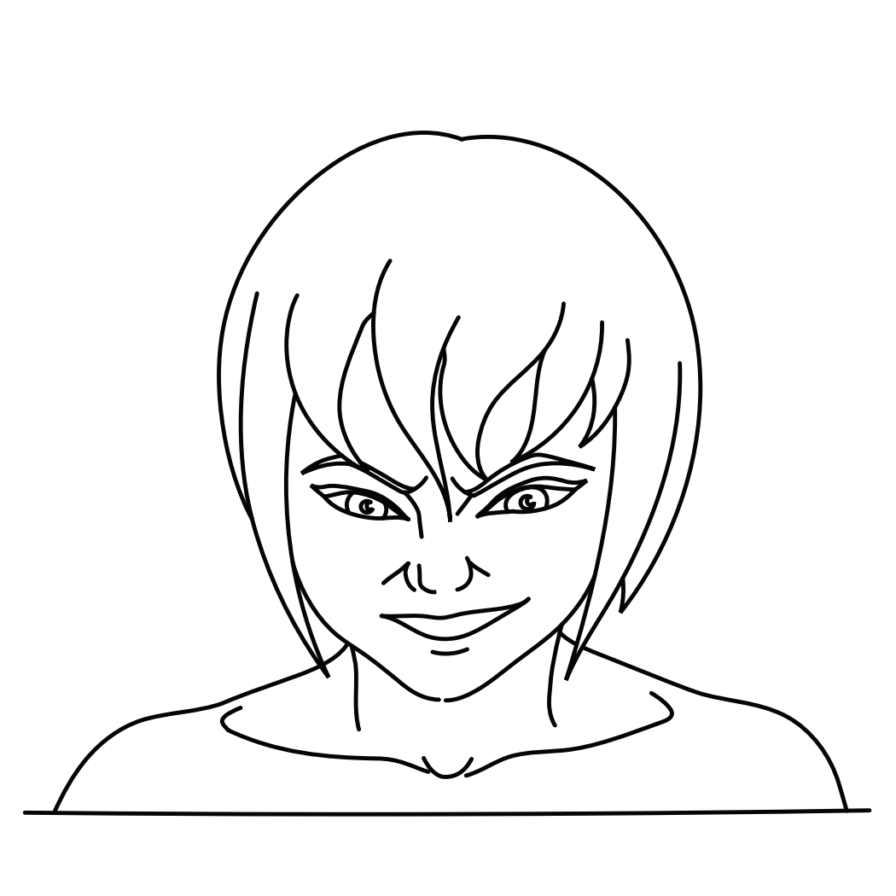 | 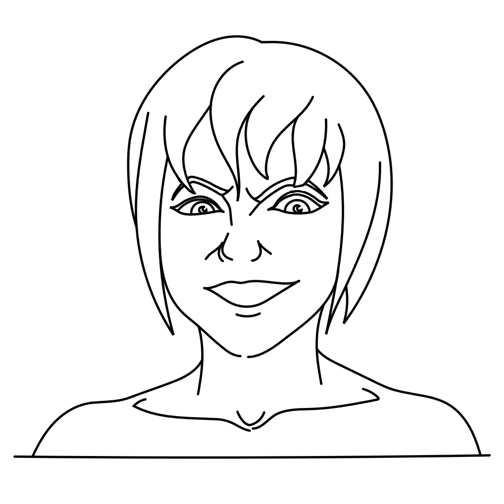 | 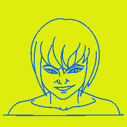 |
| B |  |  | 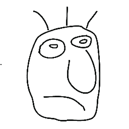 |
| C | 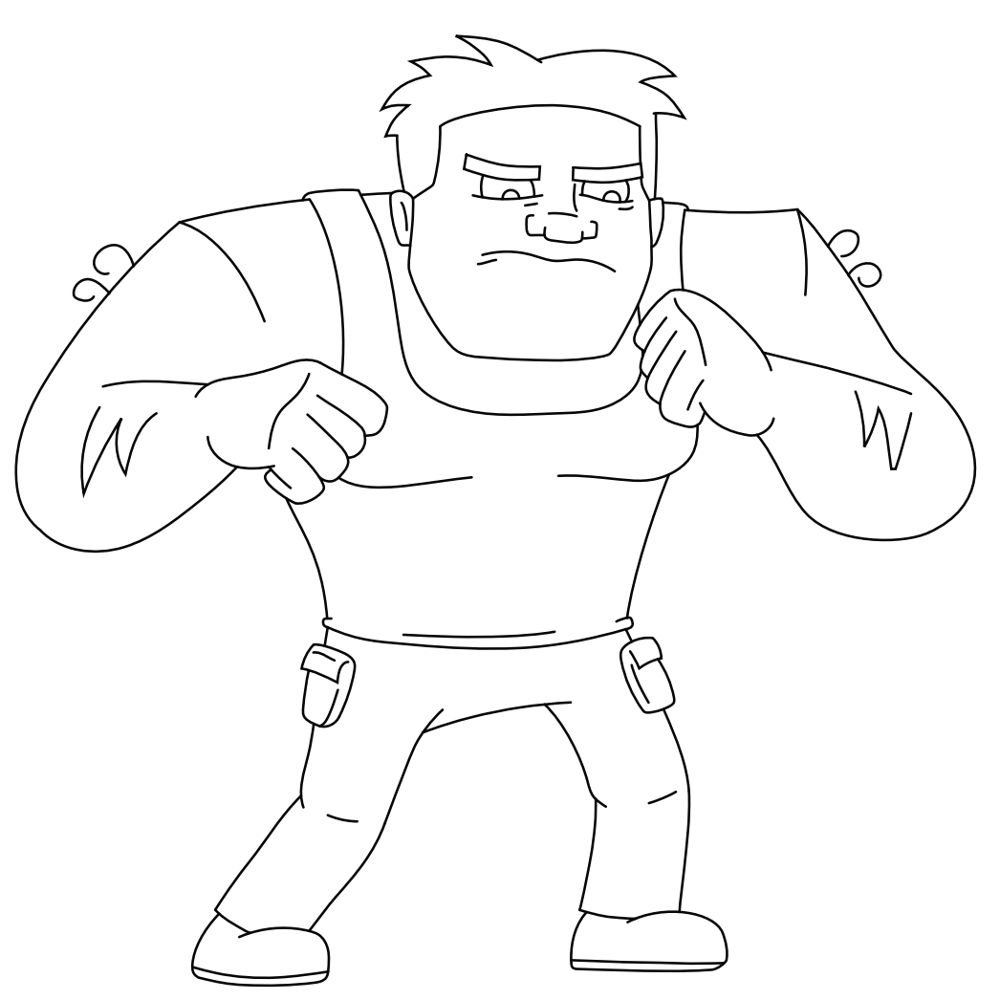 | 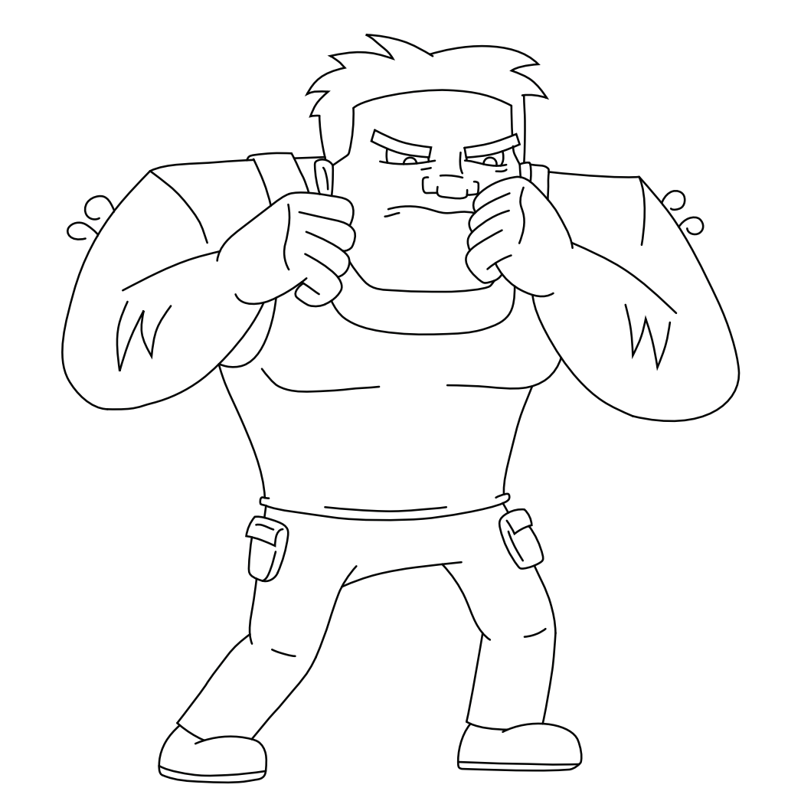 | 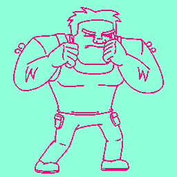 |
| D |  |  |  |
| E |  |  |  |
| F | 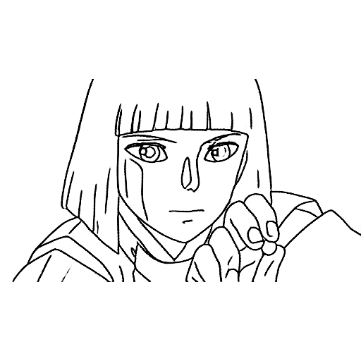 | 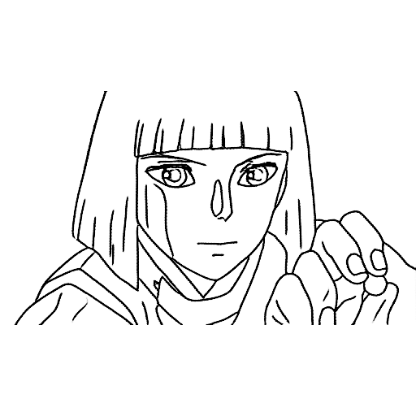 |  |
| G | 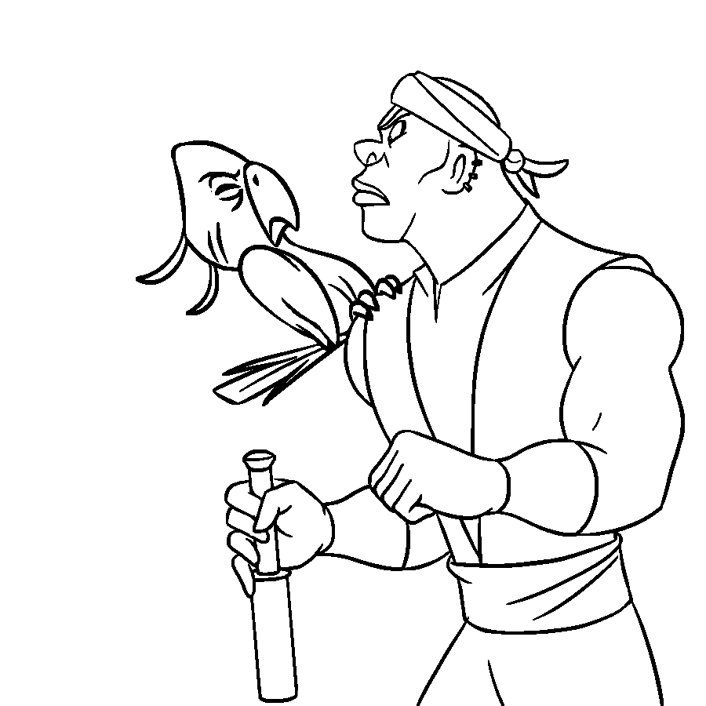 | 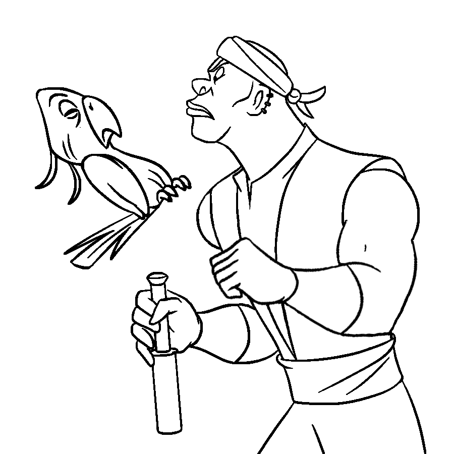 | 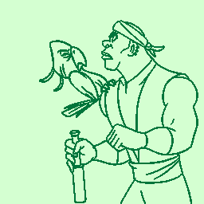 |
| H | 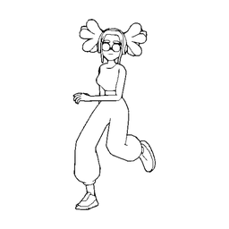 | 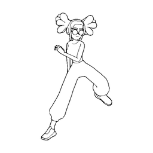 | 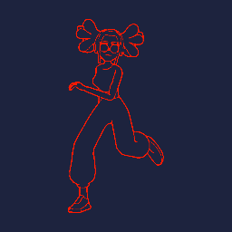 |
| I |  |  |  |

Example H currently includes only a result GIF; its start and end PNGs are not in `docs/result_gifs/`.

## Application Screenshots

### Upload keyframes

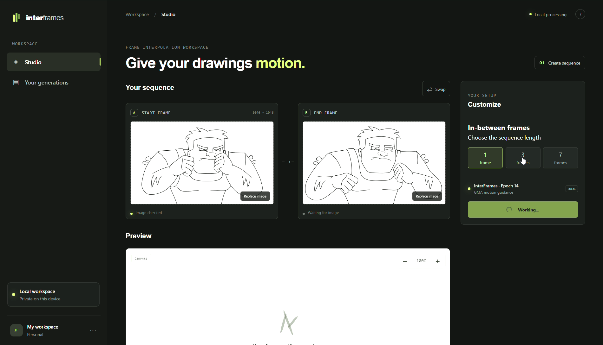

### Generate in-between frames

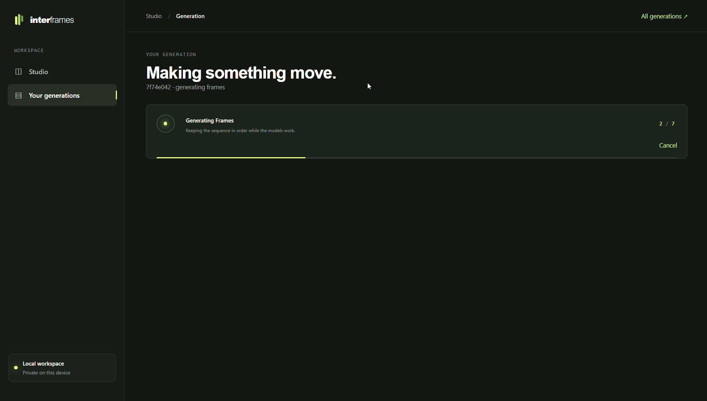

### Preview the output

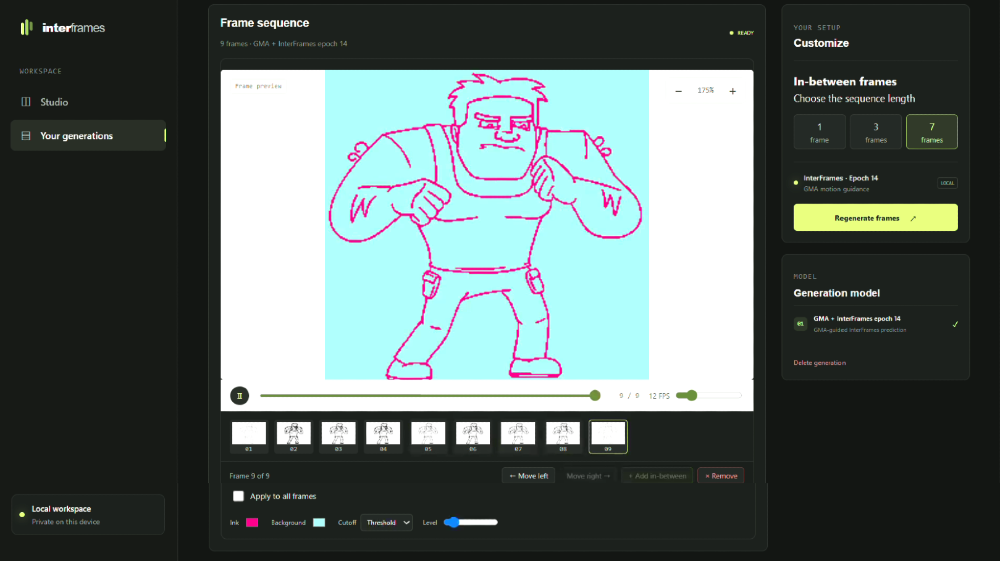

### Export the sequence

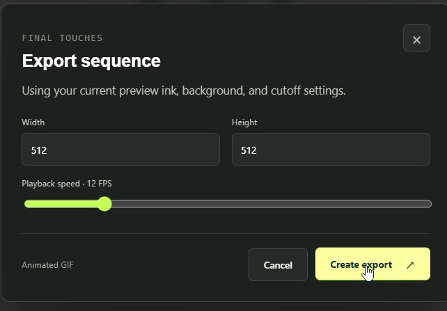

### Browse generation history

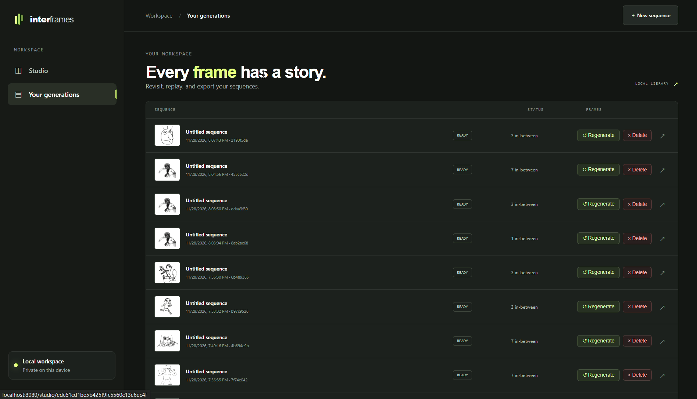

## Quick Start

1. Install Python 3.12+ and Node.js 20+.
2. Create and activate a virtual environment from the repository root:

   ```powershell
   py -3.12 -m venv .venv
   .\.venv\Scripts\Activate.ps1
   ```

3. Place the three model files under `models/`:
   - `Interframes_Model/epoch14.keras`
   - `GMA_Model/gma.pth`
   - `Moderation_Model/moderation.safetensors`

   See [System Architecture](docs/system-architecture.md) for details on each model.

4. Install dependencies and start the backend:

   ```powershell
   python -m pip install -r backend/requirements-ml.txt
   uvicorn app.main:app --app-dir backend --reload
   ```

5. In a second terminal, install and start the frontend:

   ```powershell
   cd web
   npm install
   npm run dev
   ```

6. Open the Vite URL (normally `http://localhost:5173`). The API runs at `http://localhost:8000`.

## Docker Compose

Run `docker compose up --build` from the repository root. This starts five containers — three model servers (moderation, GMA, InterFrames), the FastAPI backend, and the React web app. SQLite data and generated files persist in a Docker volume. Open `http://localhost:8080`.

### Kaggle Inference Mode

For GPU inference without local model weights, use the Kaggle hybrid mode. You need two files attached as a Kaggle input dataset:

- [models.zip](https://drive.google.com/file/d/1ecLTIFNVF7I8OGS9NeEaVsjV77fsr2xi/view?usp=sharing) — contains all three model weight files.
- [kaggle_setup.zip](https://drive.google.com/file/d/12fEFGe1hIsUNj5zhJ-2fsm9bVvb-tSHD/view?usp=sharing) — contains the backend source and model configs.

Import [the Kaggle gateway notebook](scripts/kaggle_setup.ipynb), run its cells, and copy the printed gateway URL and token into your `.env` file. Then start the app with:

```bash
docker compose -f docker-compose.yml -f docker-compose.kaggle.yml up --build
```

The Kaggle session must stay running. This mode runs only two local containers (web and backend) and routes all model requests to the Kaggle GPU over HTTPS.

## Environment

The root `.env` file is ignored by Git and holds local credentials and settings. Use `.env.example` as the shareable template. The local Python server, Vite dev server, Docker Compose, and the Kaggle setup all read from this file.

> **Note:** The local API is single-user. It stores jobs, uploaded artwork, and generated frames under `backend/data/`. The NSFW classifier fails closed — uploads are rejected when the model is unavailable. Do not expose this setup to a network or use it as a hosted multi-user service.

## Project Map

| Resource | Description |
|---|---|
| [Backend](backend/README.md) | API server, persistent job queue, validation, and inference pipeline |
| [Web App](web/README.md) | React/Vite studio and generation history UI |
| [System Architecture](docs/system-architecture.md) | End-to-end diagrams, file roles, model weights, and wire protocol |

The three model checkpoint files are not tracked by Git. They live in `models/Interframes_Model`, `models/GMA_Model`, and `models/Moderation_Model`.


## Contributers
**Uzair Majeed** &
**Faez Ahmed**