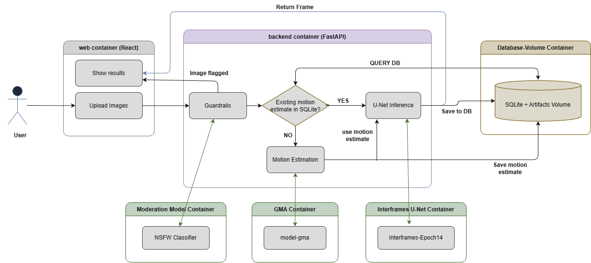

# InterFrames — System Architecture

InterFrames is a local line-art frame interpolation application. Given two endpoint drawings (Start and End), it validates and moderates the uploads, computes coarse optical flow with AnimeRun GMA, recursively predicts 1, 3, or 7 midpoint frames with the Epoch-14 InterFrames U-Net, and lets the user preview, edit, regenerate, and export the sequence as a GIF or PNG ZIP.

---

## 1. System Architecture

### Deployment Modes

**Docker Compose (5 containers)** — Run `docker compose up --build` to start `web`, `backend`, `model-moderation`, `model-gma`, and `model-interframes` on an internal bridge network with a shared `interframes_data` volume.

**Docker + Kaggle Gateway (3 local containers)** — Run `docker compose -f docker-compose.yml -f docker-compose.kaggle.yml up --build`. The three local model containers are disabled; model requests route over HTTPS with bearer-token auth to `model_gateway.py` running on a Kaggle GPU notebook via a Cloudflare Quick Tunnel.

**Single-process local Python** — Run `uvicorn app.main:app --app-dir backend` without setting any `*_SERVICE_URL` variables. All three model weights load lazily in-process; no Docker required.

---

## 2. File Roles

### Backend — Entrypoints and Config

**config.py** — Reads `.env` and environment variables: model directory, database path, artifacts directory, moderation threshold, upload size/pixel limits, model service URLs, and pinned SHA-256 hashes for each weight file.

**schemas.py** — Pydantic request and response models used across the API: AssetResponse, GenerationInput, FrameExportStyle, ExportInput, InsertFrameInput, and ErrorResponse.

**main.py** — Creates the FastAPI application, initialises the SQLite database and starts the background worker thread on startup, configures CORS, mounts the asset and generation routers under `/api/v1`, and exposes a `/health` endpoint.

**worker.py** — Runs a daemon thread that polls for queued jobs, claims one atomically, calls the inference pipeline, and writes the final status (ready, cancelled, or failed) back to the database.

**model_service.py** — Standalone FastAPI server used inside each Docker model container. Accepts a `MODEL_SERVICE_KIND` environment variable (moderation, gma, or interframes), loads the matching model, and exposes `GET /health` plus `POST /predict`.

**model_gateway.py** — Single-process FastAPI server for Kaggle hosting. Loads all three models at startup, checks a bearer token on every request, and exposes `/{kind}/health` and `/{kind}/predict`.

**wait_for_models.py** — Startup script for the backend container. Polls the configured model health endpoints in a loop until all three respond, then exits so the backend can start.

### Backend — Database

**session.py** — Creates the SQLite schema (assets, generations, exports tables), enables WAL mode, and provides a transactional `connect()` context manager.

**repositories.py** — All SQL queries live here: asset CRUD, idempotent job creation, atomic job claiming with row locking, cursor-paginated history listing, cancellation flag checks, and export record management.

### Backend — API Routers

**assets.py** — Handles `POST /assets` (upload validation, moderation scoring, PNG storage, database insert) and `GET /assets/{id}/preview` (serves the stored image).

**generations.py** — Handles job queuing, status polling, frame retrieval, single-pair midpoint insertion, cancellation, deletion, history listing, and export creation with download.

### Backend — Services

**guardrails.py** — Validates uploaded files: checks MIME type (PNG, JPEG, WebP), enforces byte and pixel limits, rejects animated images and decompression bombs, normalises EXIF orientation, composites transparency onto white, and computes a canonical pixel-level SHA-256 for deduplication.

**storage.py** — Writes uploaded PNGs atomically (writes to a `.part` temp file first, then renames) into the artifacts directory. Also handles file deletion during cleanup.

**model_clients.py** — HTTP client for remote model services. Sends JSON requests with optional bearer auth, encodes images as base64 PNGs, and decodes base64-encoded NumPy arrays from responses.

**features.py** — Builds the 8-channel 256x256 input tensor for the InterFrames model. Upsamples the 32x32 GMA flow field, bilinearly warps the start and end ink images, computes capped Euclidean distance maps, and stacks all eight channels.

**inference.py** — Orchestrates the full generation pipeline. Caches GMA flow fields on disk as `.npy` files keyed by content hash. Runs recursive binary midpoint subdivision (depth 1, 2, or 3 for 1, 3, or 7 frames), writes each predicted frame as a PNG, and exposes a single-pair interpolation function for frame insertion.

**render.py** — Post-processes predicted frames for export. Applies one of three ink filtering modes (raw, threshold, or crisp Gaussian de-halo), colorises ink and background, resizes with Lanczos, and packages results as animated GIFs or PNG ZIP archives.

### Backend — Model Adapters

**moderation.py** — Scores RGB images for NSFW content using a SafeTensors classifier on CPU (or via a remote service). Returns a score and a blocked boolean. The system fails closed: if the model is unavailable, uploads are rejected.

**gma.py** — Verifies the GMA checkpoint hash, loads the RAFT-GMA network, and computes bidirectional 32x32 optical flow between the two endpoint drawings. Falls back to the remote service when a URL is configured.

**interframes.py** — Verifies the Keras checkpoint hash, runs the U-Net on the 8-channel feature tensor, applies sigmoid to the output logits, and returns grayscale predicted ink. Includes a preprocessing function that fits input drawings onto a 256x256 white canvas.

### Frontend

**main.tsx** — Entry point. Mounts the React app inside a BrowserRouter.

**router.tsx** — Maps URL paths to pages: `/studio` (upload workspace), `/studio/:id` (generation viewer), and `/history` (saved generations).

**lib/api.ts** — Typed fetch client wrapping every backend endpoint: asset upload, generation creation, regeneration, frame insertion, cancellation, deletion, history listing, and export.

**lib/renderInk.ts** — Client-side canvas pixel processor. Implements the same three ink filtering modes as the backend (raw, threshold, crisp) plus hex-colour ink and background application, so the preview matches what the export produces.

**hooks/useGeneration.ts** — React hook that polls the generation status endpoint every 900 ms while a job is queued or running, and stops once the job completes or fails.

**pages/StudioPage.tsx** — Upload workspace. Shows two drop zones for Start and End drawings, a swap button, the frame count selector, and a preview player once both images are uploaded.

**pages/GenerationPage.tsx** — Generation viewer. Displays job progress, an interactive canvas player (defaults to crisp mode at 0.5 cutoff), frame sequence editing controls (reorder, insert in-between, remove), a regenerate panel, model summary, delete button, and the export dialog.

**pages/HistoryPage.tsx** — Lists all past generations with pagination.

**components/history/GenerationList.tsx** — Fetches paginated generation records and renders loading, empty, error, and data states. Removes a row from its local state when the user deletes a generation.

**components/history/GenerationRow.tsx** — Renders a single history entry with a thumbnail, status badge, frame count, and Regenerate and Delete action buttons.

**components/studio/EndpointUpload.tsx** — File-input card for uploading the Start (A) or End (B) drawing. Shows upload progress and validation errors.

**components/studio/CustomizationPanel.tsx** — Reusable panel with 1/3/7 frame count buttons and a Generate or Regenerate action button.

**components/studio/CanvasPlayer.tsx** — Canvas-based playback controller. Includes play/pause, a frame scrubber, FPS slider, zoom, a thumbnail strip, a frame action bar for reordering and removal, and per-frame or global ink, background, and cutoff controls.

**components/studio/ExportDialog.tsx** — Modal for exporting the final sequence. Inherits ink, background, cutoff, and frame order from the preview. Prompts only for output width, height, and FPS (for GIFs).

**styles.css** — Application-wide CSS: dark theme colour tokens, responsive layout grids, player control styling, modal overlays, and history list layout.

---

## 3. Model Weights and Verification

Each model file is verified against a pinned SHA-256 hash at load time. If the hash does not match, the backend refuses to start.

| Artifact | Path | SHA-256 |
|---|---|---|
| InterFrames Epoch 14 | `models/Interframes_Model/epoch14.keras` | `8a5cde4b...045440` |
| AnimeRun GMA | `models/GMA_Model/gma.pth` | `4a9faacb...338149` |
| NSFW Classifier | `models/Moderation_Model/moderation.safetensors` | `97b2ce64...cd5830` |

---

## 4. Model Service Wire Protocol

Each model service exposes two endpoints: `GET /health` (readiness probe) and `POST /predict` (JSON body with base64-encoded data).

| Service | Request | Response |
|---|---|---|
| Moderation | `image` — base64 PNG | `score` (float), `blocked` (bool) |
| GMA | `start`, `end` — base64 PNGs | `flow` — base64 float16 array, shape 2 x 32 x 32 x 2 |
| InterFrames | `start`, `end` — base64 float32 arrays (256 x 256), `flow` — base64 float16 (2 x 32 x 32 x 2) | `ink` — base64 float32 array (256 x 256) |
