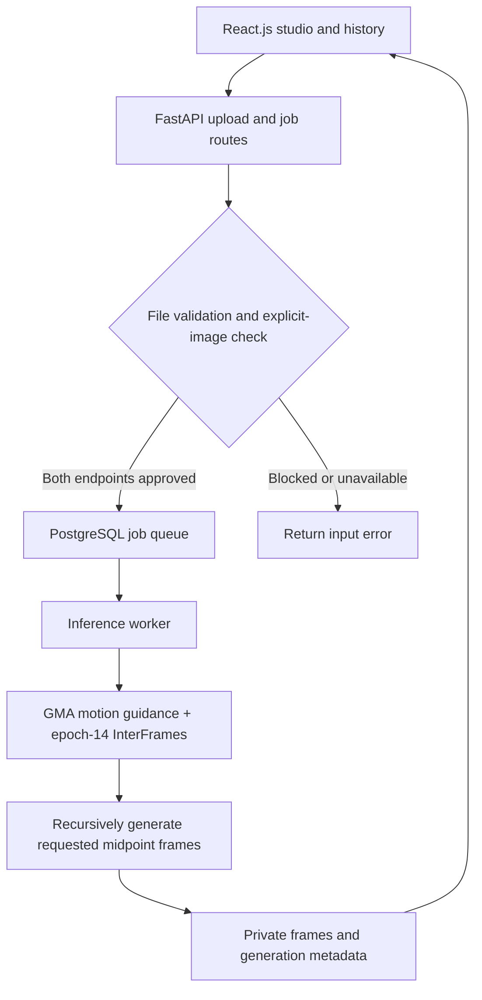

# InterFrames implementation

Build a React.js workspace and FastAPI service that generate 1, 3, or 7 in-between frames from two line drawings. The pipeline uses AnimeRun-trained GMA for motion guidance and the epoch-14 InterFrames model for every generated midpoint. Users choose 1, 3, or 7 in-between frames; the app does not ask for a timeline gap.

## 1. Install the model artifacts

Run setup from the repository root. Store weights under `models/` and git checkouts under `vendor/`. Mount both read-only for inference.

### Explicit-image classifier

Use **Falconsai NSFW Image Detection** for input moderation. Download the pinned model, processor configuration and Safetensors weights. [Model card](https://huggingface.co/Falconsai/nsfw_image_detection) · [Pinned weights and SHA-256](https://huggingface.co/Falconsai/nsfw_image_detection/blob/7a365063de11be8a4b975ebe63733c112a819887/model.safetensors)

```bash
set -eu
python -m pip install huggingface_hub
hf download Falconsai/nsfw_image_detection config.json preprocessor_config.json model.safetensors \
  --revision 7a365063de11be8a4b975ebe63733c112a819887 --local-dir models/moderation
echo "97b2ce64ec146884b37f98ee7944ca4891aa72f6827dc0cb10684a1cbecd5830  models/moderation/model.safetensors" | sha256sum -c -
```

Load `AutoImageProcessor` and `AutoModelForImageClassification` in `models/moderation.py` from `models/moderation/` with `local_files_only=True` and `trust_remote_code=False`. Use `use_safetensors=True` for the model. Keep the model resident on CPU per API process and bound scoring concurrency. Score sanitized RGB images in evaluation and inference mode. Apply softmax and resolve the `nsfw` class from the checkpoint label map. Configure the blocking threshold in `guardrails.py` and calibrate it on representative line drawings before launch. Include the classifier revision and threshold in the moderation policy version. [Pinned label map](https://huggingface.co/Falconsai/nsfw_image_detection/blob/7a365063de11be8a4b975ebe63733c112a819887/config.json)

### GMA

Use the AnimeRun checkpoint and code revision from notebook 10. [Checkpoint and published SHA-256](https://huggingface.co/dreMaz/AnimeRun_ckpt/blob/main/20000_gma-animerun-v2-ft.pth) · [GMA source](https://github.com/zacjiang/GMA)

```bash
set -eu
mkdir -p vendor models/gma
git clone https://github.com/zacjiang/GMA.git vendor/GMA
git -C vendor/GMA checkout --detach 2f1fd29468a86a354d44dd25d107930b3f175043
weight=models/gma/20000_gma-animerun-v2-ft.pth
curl --fail --location --retry 3 -o "$weight.part" \
  https://huggingface.co/dreMaz/AnimeRun_ckpt/resolve/76eeaa2ebfcd8714088faabcd65bacc7d621cd15/20000_gma-animerun-v2-ft.pth
echo "4a9faacbec5d095e019fcbba9e19871c9df9c097854f6617c7e376928c338149  $weight.part" | sha256sum -c -
mv "$weight.part" "$weight"
```

### InterFrames model from the Stage 10 ZIP

Use `10_Interframes_Final_Results.zip`. Notebook 10’s export puts the model and protocol in `interframes_final_test/`. Extract just those two known members and verify the model against the recorded SHA-256.

```bash
python - 10_Interframes_Final_Results.zip <<'PY'
import hashlib
import json
import sys
from pathlib import Path
from zipfile import ZipFile

with ZipFile(sys.argv[1]) as archive:
    root = "interframes_final_test/"
    protocol = json.loads(archive.read(root + "test_protocol.json"))
    model = archive.read(root + "model/epoch_014.keras")

digest = hashlib.sha256(model).hexdigest()
if protocol["epoch"] != 14 or protocol["model_sha256"] != digest:
    raise SystemExit("The InterFrames checkpoint does not match the Stage 10 test protocol.")

target = Path("models/Interframes_Model/epoch14.keras")
target.parent.mkdir(parents=True, exist_ok=True)
temporary = target.with_suffix(".part")
temporary.write_bytes(model)
temporary.replace(target)
print(f"Verified {target} ({digest})")
PY
```

Use the Stage 10 export containing both the checkpoint and its protocol. Vendor the tested Stage 1 `modules/data.py` and `modules/learning.py` with their licenses and record their hashes from `stage1_complete.json`. No dataset or test-flow cache is required to serve uploads.

## 2. Project structure

```text
backend/
  app/
    main.py                 FastAPI app and HTTP router registration
    config.py               Limits, paths, model release and execution settings
    schemas.py              Typed requests, results and error codes
    api/
      assets.py             Upload and moderate endpoint images
      generations.py        Submit, poll, list, cancel and delete jobs
      exports.py            Authorize PNG previews and build downloads
    database/
      session.py            PostgreSQL connections and transactions
      models.py             Assets, moderation decisions, jobs and exports
      repositories.py       Owner-scoped queries and history
    cache/
      keys.py               Versioned motion and prediction identities
      store.py              Cache reads, atomic writes and eviction
    services/
      guardrails.py         File, moderation and output validation
      inference.py          Prepare endpoints, run the route and subdivide
      render.py             PNG and GIF encoding from saved frames
      storage.py            Private files or object storage
      jobs.py               Database claims, leases and progress
    models/
      gma.py                Load GMA and estimate bidirectional flow
      interframes.py        Load the InterFrames model and predict midpoint ink
      moderation.py         Load the explicit-image classifier and score uploads
    worker.py               Claim and execute durable jobs
  migrations/               PostgreSQL schema versions
  data/cache/               Local runtime cache on a private volume
  data/artifacts/           Local private PNGs and exports
web/
  index.html
  vite.config.ts
  src/
    main.tsx
    router.tsx              React Router route definitions
    pages/
      StudioPage.tsx
      GenerationPage.tsx
      HistoryPage.tsx
    components/
      studio/EndpointUpload.tsx
      studio/EndpointUpload.tsx
      studio/CustomizationPanel.tsx
      studio/GenerationProgress.tsx
      studio/CanvasPlayer.tsx
      studio/FrameStrip.tsx
      studio/ExportDialog.tsx
      history/GenerationList.tsx
      history/GenerationRow.tsx
    hooks/useGeneration.ts    Poll active jobs and handle terminal states
    lib/api.ts                Typed API client
    lib/renderInk.ts          Shared browser preview transform
```

HTTP handlers own authentication and request parsing. The worker calls `inference.py`, which uses the GMA and InterFrames adapters. Model adapters take validated inputs and return predictions. They have no HTTP or database dependencies. Use React.js, TypeScript and Vite. Map React Router to `/studio`, `/studio/:id` and `/history`. Serve the compiled app with an index fallback for direct navigation and proxy `/api/v1/` to FastAPI. [FastAPI module structure](https://fastapi.tiangolo.com/tutorial/bigger-applications/) · [React setup](https://react.dev/learn/build-a-react-app-from-scratch)



## 3. Inference and model routing

- **Preprocessing.** Apply the notebook 10 normalization. Composite alpha onto white, convert to grayscale and center the aspect-preserving resize on a white 256 × 256 canvas. Convert to float32 ink with `1 - gray / 255`. Use the normalized image tensor for inference.
- **GMA and InterFrames.** Convert the endpoints to 8-bit grayscale replicated into RGB on the 0–255 scale for GMA. Estimate both directions at 12 iterations. Use the coarse output packed as float16 `(2, 32, 32, 2)`. Reuse Stage 1 `features_from_low` for the eight InterFrames input channels, including warped ink, distance and coverage maps. The InterFrames model encodes with three downsampling blocks, combines decoder features with skip connections, and emits one logit per pixel. Apply sigmoid once to get continuous ink.
- **Frame generation.** Do not request a guessed source-frame gap. Generate the selected 1, 3, or 7 in-betweens recursively with GMA motion guidance and the same epoch-14 InterFrames model for every midpoint.
- **Output checks.** Validate shape, finite ink in [0,1], frame count and ordering before saving. Flag empty or saturated midpoints and abrupt changes in ink area. Calibrate quality warnings on validation pairs. If the InterFrames model fails hard validation, return a job error without publishing a partial sequence.

## 4. Studio, settings and history

Use a dark studio with a white drawing canvas, graphite controls and a lime primary action. Keep **Studio** and **Your generations** on the left, endpoint uploads and playback in the center, customization on the right. Stack the controls below the canvas on narrow screens. [Visual reference](https://dribbble.com/shots/26882941-AI-Image-generator-website)

| Control | Behavior |
|---|---|
| Start and end PNGs | Show both endpoint previews. Support replacement and swapping, . |
| Generation | Choose 1, 3, or 7 in-betweens. The same model pipeline handles every requested sequence. |
| Preview | Play/pause, scrubber, frame thumbnails, width, fit/zoom and FPS. Use real job stages such as checking uploads, estimating motion, generating frames and ready. Show an indeterminate spinner for stages without a known total. |
| Ink and background | Ink cutoff with raw mode, ink color and background color. Apply cutoff to generated frames. Color and FPS can update instantly using stored grayscale frames. |
| Export | GIF or numbered PNG ZIP. Accept width and height with an aspect-preserving fit by default. Export dimensions rescale the 256 × 256 model result. Preview width can be set independently. |
| Your generations | List rows with a PNG thumbnail, short ID or title, date and status. Open a row to play its stored frames. Build the GIF on demand with the saved or current export settings. |

Keep canonical lossless grayscale PNGs as private artifacts and persist ordering, palette, cutoff, FPS, model identities and file keys in the database. Use the saved raw ink arrays where exact threshold parity is required. Generate a new export from the same sequence when render settings change.

## 5. API, guardrails and cache

| Endpoint | Contract |
|---|---|
| `POST /api/v1/assets` | Multipart image. Run file validation and moderation, then return an asset ID and authorized preview. |
| `POST /api/v1/generations` | Accept two asset IDs and an in-between count and initial preview settings. Require an idempotency key. Return a job ID. |
| `GET /api/v1/generations/{id}` | Return status, completed/total midpoints, per-frame models, warnings and available preview keys. |
| `GET /api/v1/generations` | Cursor-paginated owner-scoped history. |
| `POST /api/v1/generations/{id}/exports` | Queue or retrieve a GIF or PNG ZIP for the requested palette, FPS, cutoff and dimensions. Return an export ID and status. |
| `GET /api/v1/generations/{id}/exports/{export_id}` | Return the export status and an authorized download when ready. |
| `POST /api/v1/generations/{id}/cancel`, `DELETE /api/v1/generations/{id}` | Cancel work or remove history and schedule file cleanup. |

**Input gate.** Enforce image byte and pixel limits and decode each static image fully before scoring it with `moderation.py`. Only approved assets get a persistent asset ID or preview. Return `422 CONTENT_BLOCKED` for a policy block and `503 MODERATION_UNAVAILABLE` if the classifier cannot score. Both endpoints must have approvals for their current pixel hashes and policy version before queueing or using a generation cache hit. Rescore when the pixels or policy version change. Test on representative line drawings, including benign anatomy and solid fills. Enforce render dimension and job quotas. Authorize every asset and artifact against the signed-in owner. [OWASP upload guidance](https://cheatsheetseries.owasp.org/cheatsheets/File_Upload_Cheat_Sheet.html)

**Database.** Keep PostgreSQL connections, table definitions and queries in `backend/app/database/`. Keep schema revisions in `backend/migrations/`. Store asset ownership, moderation decisions, job leases, ordered frame keys and export metadata in PostgreSQL. Keep actual image and export bytes in private artifact storage.

**Durable jobs.** Use PostgreSQL for job state and history. Claim work with row locks and leases, heartbeat during processing, and publish artifacts only for the current lease. Use a temporary path and atomic publication. Keep artwork out of logs. Use owner-scoped storage and remove references to artifacts and cache entries on deletion.

| Cache entry | Key within the owner scope |
|---|---|
| GMA flow | Both ordered canonical input image hashes, GMA digest, preprocessing revision and iteration count. Use the local worker cache or the hosted worker’s private cache. |
| Raw midpoint | Exact endpoints, model and feature revisions, flow identities. Reuse an unchanged root when extending a sequence. |
| Export | Accepted sequence hash and render settings. Color, cutoff, FPS and resize changes reuse predictions. |

Implement cache keys and storage in `backend/app/cache/`. Set `CACHE_DIR=backend/data/cache` locally and use a private cache prefix in hosted storage. Keep runtime cache and artifact files out of version control. Bound cache storage and use one writer per key. Batch both flow directions and sibling midpoint predictions where memory permits. Load model weights once per worker. Track time spent in decoding, moderation, flow, prediction and rendering separately.

## 6. Local and hosted execution

| Mode | Implementation |
|---|---|
| Local | Run React.js via Vite, FastAPI, the worker and PostgreSQL locally. Load artifacts from `models/` and persist artwork and caches under a private data directory. Benchmark CPU latency before setting expectations. Enable supported GPU acceleration through worker configuration. |
| Hosted | Serve the static Vite build and run the same API and worker with a hosted GPU and private object storage. Use the pinned artifacts from section 1, or fetch a versioned Kaggle model or notebook-output artifact during setup and verify its manifest. Use a hosted API URL for interactive uploads. Kaggle model URLs provide downloadable artifacts; Kaggle notebook jobs can run offline batches and expose completed output. |

Use one API contract in both modes. Configure the API base URL per deployment and keep inference workers on private networks. Keep credentials on the server. [Kaggle model downloads](https://github.com/Kaggle/kagglehub) · [Kaggle notebook runs and output downloads](https://github.com/Kaggle/kaggle-cli/blob/main/docs/kernels.md)

## 7. Build and verify

1. Reproduce one notebook 10 midpoint locally using the Stage 10 ZIP and pinned GMA checkpoint. Verify preprocessing, directions, feature shapes, checkpoint hash and output parity.
2. Connect uploads, moderation, jobs, playback, history and GIF/PNG exports. Test allowed, blocked, malformed and classifier-unavailable uploads. Verify blocked inputs never reach the job queue. Test refresh, restart, cancellation, reupload cache hits and cross-account isolation. Verify render-only changes make zero inference calls.
4. Run the same fixture locally and on the hosted worker. Verify each mode loads the same model identities, produces correctly ordered frames and respects the same guardrails.
