# InterFrames · Experiment history

**Final model.** An AnimeRun-trained GMA motion estimator and a distilled, 1.10-million-parameter U-Net predict a single middle drawing from two endpoint drawings. Distilled epoch 14 achieved **0.84077 line F1** on 53,290 test triplets from 100 sequences. The result depends strongly on temporal spacing. F1 was **0.96007 at gap 1**, **0.86566 at gap 2**, and **0.69053 at gap 4**. All three used the same 256 × 256 resolution.

**What changed the drawings most.** The original U-Net captured many reference lines but spread ink over too much of the image. Reducing the training weight on ink helped. Learned warp masks added little in matched comparisons. Switching motion estimators and training with explicit penalties for excess ink, alongside quality-weighted teacher drawings, produced a student with higher precision and thinner predictions. Some reference strokes were lost in the process.

## How to read the experiments

- **A triplet** contains a start drawing, a true middle drawing, and an end drawing. For middle frame 55, gap 1 uses frames 54 and 56; gap 2 uses 53 and 57, and gap 4 uses 51 and 59. The task is to reconstruct 55 from the two endpoints. Larger gaps generally allow more movement, although two frames can also depict a held pose.
- **A warp** moves endpoint ink halfway along its estimated optical flow to make a rough midpoint. The U-Net receives eight channels: two original drawings, two rough midpoint drawings, two distance-to-line maps, and two maps of where the warped drawings have coverage. It predicts a continuous ink value per pixel.
- **The checkpoint families** share epoch numbers. The original run trained through epoch 10. Unmasked ink-15 and masked ink-15 were sibling experiments starting from original epoch 10. The distilled branch started from **unmasked epoch 13**. Thus “masked 14” and “distilled 14” refer to different models. The pilot and full distillation runs also have separate checkpoints.
- **Evidence.** The eleven sections below follow the filenames in the supplied notebook archive. Figures are saved notebook outputs. Captions identify their split or sampling method. Small experiments are reported with their sample sizes. A preview illustrates a behavior. The aggregate tables establish its frequency or magnitude only to the extent the metric measures it.

| Measure | What it answers |
|---|---|
| Line precision ↑ | What fraction of predicted ink lies within two pixels of a reference line? |
| Line recall ↑ | What fraction of reference ink lies within two pixels of a predicted line? |
| Line F1 ↑ | How well are precision and recall balanced? A thick stroke can still earn credit if it is near the correct line. |
| Symmetric Chamfer ↓ | How far, on average, is ink from the nearest line in the other drawing, measuring in both directions? Units are pixels on the 256 × 256 canvas. |
| Ink ratio → 1 | How much thresholded area is ink relative to the reference? A ratio of 2 means twice the area. Thick strokes, doubled contours, and extra marks can all increase it. |
| Ink MAE ↓ | How different are continuous predicted and reference ink intensities? A mostly white drawing can score well while omitting important detail. |
| Validation loss ↓ | How does the model score under that run’s objective? Compare values only when the objective and weighting match. |

Formal final scoring uses a **0.50 ink cutoff** and **two-pixel tolerance**. Notebook 10 averages results within each sequence, then weights sequences equally. Its ink ratio divides the two sequence-balanced mean ink fractions. Earlier notebooks distinguish example-averaged validation ink MAE from sequence-averaged raster MAE. The tables here retain their source metric. The cutoff and color used to display a preview are separate from the formal scoring settings.

## 01 · Build the dataset and cache midpoint motion

`01_Data_Motion_Prep.ipynb`

- **Question.** Could every later experiment use the same drawings, temporal pairs, and motion inputs without spending GPU hours recomputing flow every epoch?
- **Preparation.** The notebook fitted drawings to a white 256 × 256 canvas while preserving aspect ratio. It selected every valid triplet at gaps 1, 2, and 4 with stride 1. The project used a custom split. It kept the 100 test sequences and removed four validation sequence names also present in test. This reduced validation from 44 to 40 sequences.
- **Motion check.** Frozen RAFT-Small estimated flow in both directions with 12 iterations. The TensorFlow conversion matched the saved low-grid reference to a maximum absolute error of about **0.00000205**. Two 32 × 32 float16 flow grids per pair were enough to reconstruct the rough drawings. The recorded cache run took **522.9 minutes** across all splits.
- **Decision.** Use the saved manifest, frames, flow caches, and fingerprint as the common starting point. The true middle serves as the learning target. Flow estimation uses only the endpoints.

| Effective split | Sequences | Drawings | Triplets |
|---|---:|---:|---:|
| Train | 100 | 19,930 | 58,390 |
| Validation | 40 | 9,916 | 29,188 |
| Test | 100 | 18,230 | 53,290 |

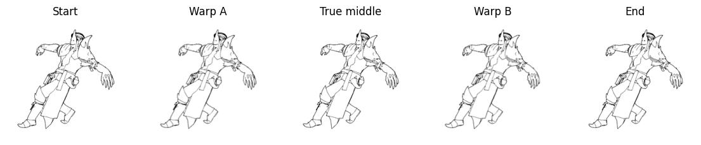

*Notebook 01, training split. From left to right: start, start warped forward, true middle, end warped backward, end. Both warps estimate the same moment from different observations.*

## 02 · Train the baseline U-Net

`02_Baseline_Training.ipynb`

- **Design.** The U-Net used three encoder levels, a bottleneck, skip connections, and a single output logit per pixel. It had **1,098,745 parameters**. Training used Adam, learning rate 0.0002, batch size 4, and frozen RAFT features. The notebook cached flows in RAM and reused image and distance data to reduce CPU preparation time.
- **Why weight ink?** White pixels dominate line drawings. The notebook estimated the imbalance from training targets and capped the positive-class weight at **30**. The loss combined weighted binary cross-entropy, 0.5 × soft Dice loss, and 0.05 × the sum of horizontal and vertical gradient errors. The positive weight chiefly increases the cost of missing true ink.
- **Result.** The completed run reached epoch 10. Validation loss went from **0.73779 at epoch 1** to a minimum of **0.72352 at epoch 7**, then rose to **0.73066 at epoch 10**. Training loss continued down to **0.70606**. Saving both the best-loss checkpoint and the latest checkpoint made it possible to compare the actual drawings.
- **Visual finding.** The network placed recognizable limbs, but nearby contours could merge into broad black regions. A single loss number could not describe that failure.

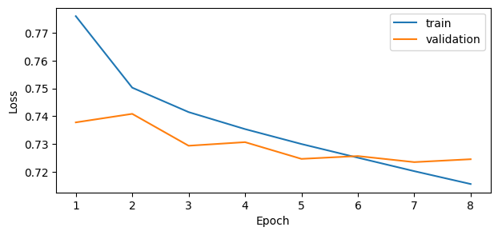

*First baseline run through epoch 8. Training loss falls throughout, while validation reaches its minimum at epoch 7.*

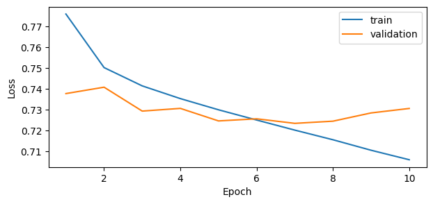

*Continuation through epoch 10. The widening gap over epochs 8–10 explains why the notebook retained both best-loss and latest checkpoints.*

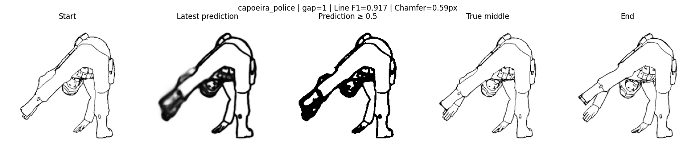

*Notebook 02, latest-checkpoint validation preview. The thresholded leg in the center panel carries substantially more ink than the reference leg beside it.*

## 03 · Evaluate baseline checkpoints and simple alternatives

`03_Baseline_Training_Continued.ipynb`

- **What actually ran.** The Colab notebook restored the completed epoch-10 run. Its target was already 10, so it **skipped training** and evaluated epochs 7 and 10 on all 29,188 validation triplets. It also scored copying the start, averaging the endpoint images, and averaging the two warps.
- **Finding.** Epoch 7 minimized the original loss. Epoch 10 had better F1, Chamfer, and ink MAE, yet produced **5.45619×** the target ink area. This made epoch 10 a useful parent for reducing excess ink. The two-pixel tolerance explains how many lines could be counted as hits while the picture still looked too heavy.

| Validation method | Val. loss | Val. ink MAE | Line F1 | Chamfer px |
|---|---:|---:|---:|---:|
| Copy start | — | — | 0.66724 | 2.34165 |
| Crossfade endpoints | — | — | 0.55975 | 2.85629 |
| Average midpoint warps | — | — | 0.58826 | 3.09144 |
| Original epoch 7 | **0.72352** | 0.09931 | 0.79191 | 1.11957 |
| Original epoch 10 | 0.73066 | **0.09168** | **0.80215** | **1.08600** |

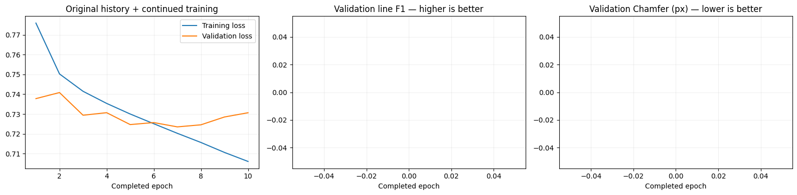

*Restored history before checkpoint re-evaluation. The two empty axes mean the old per-epoch history lacked F1 and Chamfer values. The later validation scores for epochs 7 and 10 appear in the table above.*

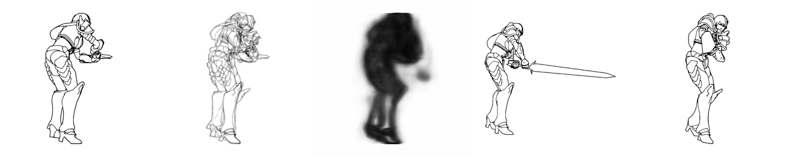

*Notebook 03, one of the lowest-F1 validation cases at epoch 7, gap 4. Start, average warp, U-Net, true middle, end. The reference sword extends well beyond the silhouette produced by the network. This is a selected failure case.*

## 04A · Reduce positive ink weight from 30 to 15

`04A_Ink15_Finetuning_Experiment.ipynb`

- **Hypothesis.** A model trained to avoid missing ink could reduce its loss by putting ink on both sides of an uncertain boundary. Lowering the positive-class weight would make that behavior less attractive.
- **Experiment.** Resume the unmasked epoch-10 weights and fine-tune the U-Net for one full epoch, using weight 15 for training and validation. Keep the RAFT inputs and dataset fixed. This retained the motion and drawing features already learned.
- **Result.** Relative to epoch 10, epoch 11 improved line F1 from **0.80215 to 0.82407**, Chamfer from **1.08600 to 1.07284 px**, and ink ratio from **5.45619× to 4.30893×**. Val. ink MAE fell from **0.09168 to 0.07049**. The new loss of 0.62621 uses a different weight, so the cross-run evidence comes from the drawing metrics.

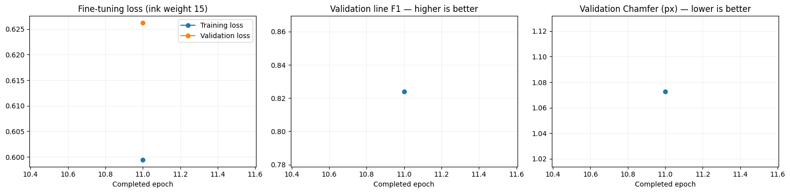

*Epoch 11 is the first point under the new ink weighting. Each quality panel contains a single observation.*

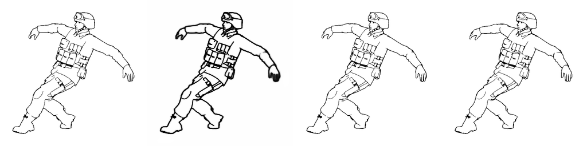

*Notebook 04A, validation. Start, epoch-11 prediction, true middle, end. The pose is recognizable. The hand and garment outlines remain heavier than the reference.*

## 04B · Continue the unmasked ink-15 branch

`04B_Ink15_Finetuning_Continued.ipynb`

- **Question.** Would continuing the same objective keep improving thin lines? The saved execution restored epoch 12 and completed epoch 13. The history preserves all three ink-15 epochs.
- **Result.** Epoch 12 gave the highest F1 and closest ink ratio in this branch. Epoch 13 gave the lowest loss and smallest Chamfer, while ink area rose again. More training improved some aspects of placement while reversing some of the gain in stroke weight.
- **Decision.** Retain epoch 13 as the available unmasked checkpoint for the later test comparison and the parent for the motion and distillation experiments. Epoch 12 remains the higher-F1 validation reference.

| Unmasked epoch | Val. loss, weight 15 | Val. ink MAE | Line F1 | Chamfer px | Ink ratio |
|---|---:|---:|---:|---:|---:|
| 11 | 0.62621 | 0.07049 | 0.82407 | 1.07284 | 4.30893 |
| 12 | 0.62642 | **0.06926** | **0.82687** | 1.07043 | **4.20542** |
| 13 | **0.62271** | 0.07109 | 0.82562 | **1.05976** | 4.35813 |

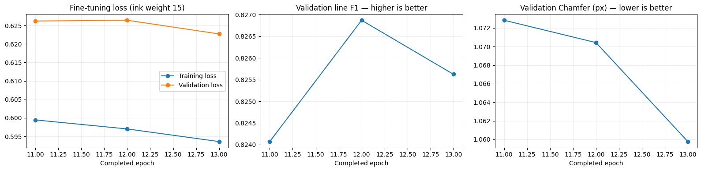

*Epoch 12 peaks in F1. Chamfer continues to fall through epoch 13, illustrating why the two criteria select different checkpoints.*

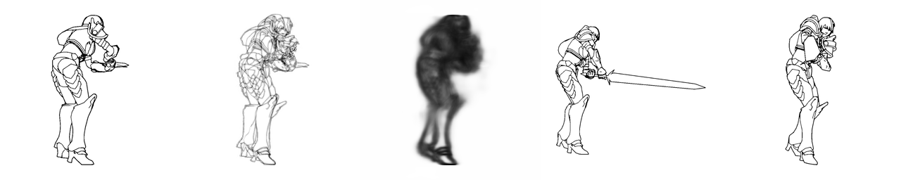

*Notebook 04B, the same gap-4 sword sequence highlighted in notebook 03. Epoch 13 still misses the extended blade on this example. A lighter average prediction does not resolve ambiguous large motion.*

## 05 · Learn which parts of each warp to trust

`05_Warp_Mask_Experiment.ipynb`

- **Hypothesis.** If an endpoint warp placed a stroke incorrectly or showed a line that should be hidden, a learned per-pixel mask might suppress it before the U-Net rendered the middle.
- **Controlled comparison.** A new branch started from the same original epoch 10, with ink weight 15. Two learned masks scaled the two warped-ink channels. They began approximately 98.2% open so the starting behavior resembled the parent. Both the masks and the U-Net could update. Matched unmasked epochs 11–13 provide the direct comparison.
- **Result.** At epoch 12, masking changed F1 by **+0.00001** and ink ratio by **−0.00079** using the rounded values. At epoch 13, F1 was identical to five decimals. These runs show little practical benefit from the masks under this setup. The larger improvement over original epoch 10 was also present in the unmasked branch.
- **Decision.** Retain masked epoch 12, the highest-F1 and lowest-ink-ratio masked checkpoint. By epoch 15 the ratio had risen to 4.62970× and F1 had fallen to 0.81847. There was no matched unmasked run at epochs 14–15.

| Epoch | Masked val. loss | Masked F1 | Unmasked F1 | Masked Chamfer px | Masked ink ratio |
|---|---:|---:|---:|---:|---:|
| 11 | 0.62620 | 0.82403 | 0.82407 | 1.07286 | 4.31002 |
| 12 | 0.62648 | **0.82688** | 0.82687 | 1.07045 | **4.20463** |
| 13 | 0.62267 | 0.82562 | 0.82562 | **1.05967** | 4.35860 |
| 14 | **0.62019** | 0.82173 | — | 1.06158 | 4.53693 |
| 15 | 0.62117 | 0.81847 | — | 1.08057 | 4.62970 |

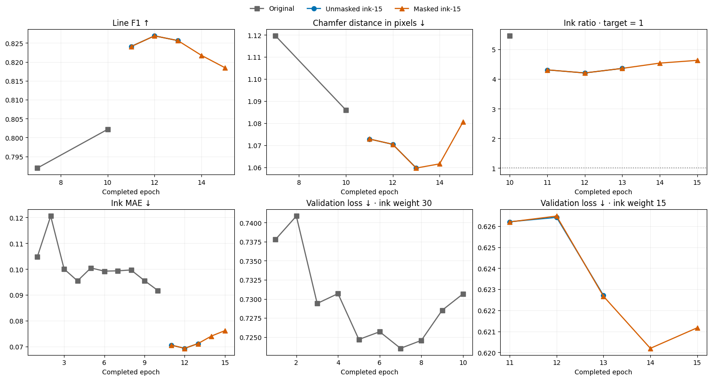

*The ink-15 F1 curves nearly coincide over their shared epochs. The bottom row separates loss by ink weighting so that each loss curve has a consistent objective.*

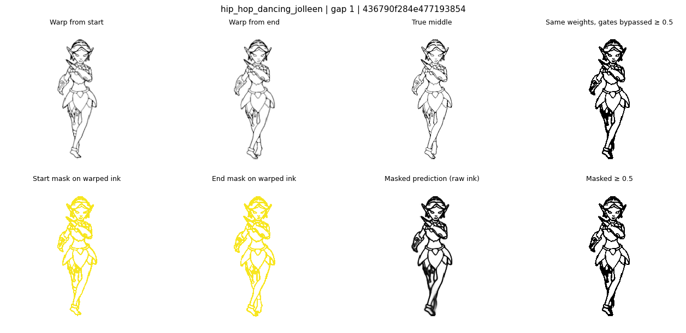

*Notebook 05, epoch 15. Yellow denotes warped ink the gate retains. The comparator in this saved panel uses the same weights with the gates bypassed. The matched, independently trained unmasked comparison is in the table.*

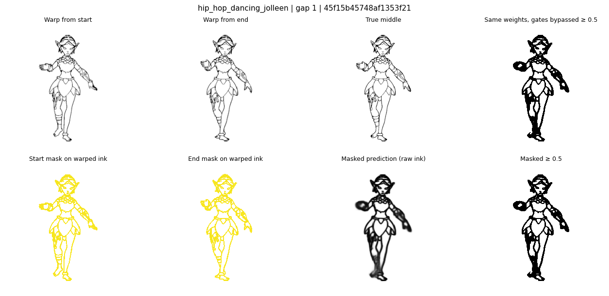

*Distorted ink with learned masks, validation, gap 1. Compare the outstretched arm and leg in the lower-right prediction with the finer lines in the true middle above. Yellow on the two gate maps indicates warped ink passing through.*

## 06 · Test three frozen checkpoints

`06_Testing_Three_Experiments.ipynb`

- **Design.** Score original epoch 7, unmasked ink-15 epoch 13, and masked ink-15 epoch 12 on the same **53,290 test triplets** and cached RAFT inputs. A common weight-15 evaluation loss made the loss column comparable across these three models. Weights stayed fixed.
- **Finding.** Both ink-15 models improved precision, F1, MAE and ink area over the original. Masked epoch 12 produced slightly less ink and had the highest F1; unmasked epoch 13 had the smallest Chamfer. The original’s recall of 0.98119 came with only 0.69654 precision and roughly five times the target ink.
- **Interpretation.** The matched-epoch validation in notebook 05 is the cleaner test of the masks. This test compared two different ink-15 epochs. Their small difference cannot be attributed solely to masking.

| Test checkpoint | Common loss | Ink MAE | Line F1 | Precision | Recall | Chamfer px | Ink ratio |
|---|---:|---:|---:|---:|---:|---:|---:|
| Original 7 | 0.63330 | 0.10475 | 0.79437 | 0.69654 | **0.98119** | 1.22355 | 5.12374 |
| Unmasked 13 | **0.61915** | 0.07575 | 0.82628 | 0.74920 | 0.94906 | **1.17395** | 3.87892 |
| Masked 12 | 0.62235 | **0.07392** | **0.82707** | **0.75245** | 0.94595 | 1.19406 | **3.75843** |

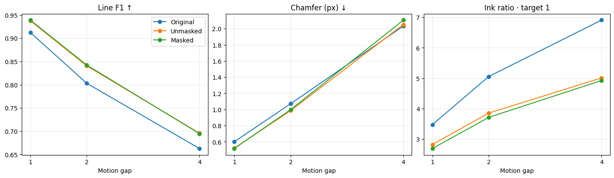

*Notebook 06, full test comparison. Read the F1 panel together with Chamfer and ink ratio to see the trade-off between the ink-15 checkpoints.*

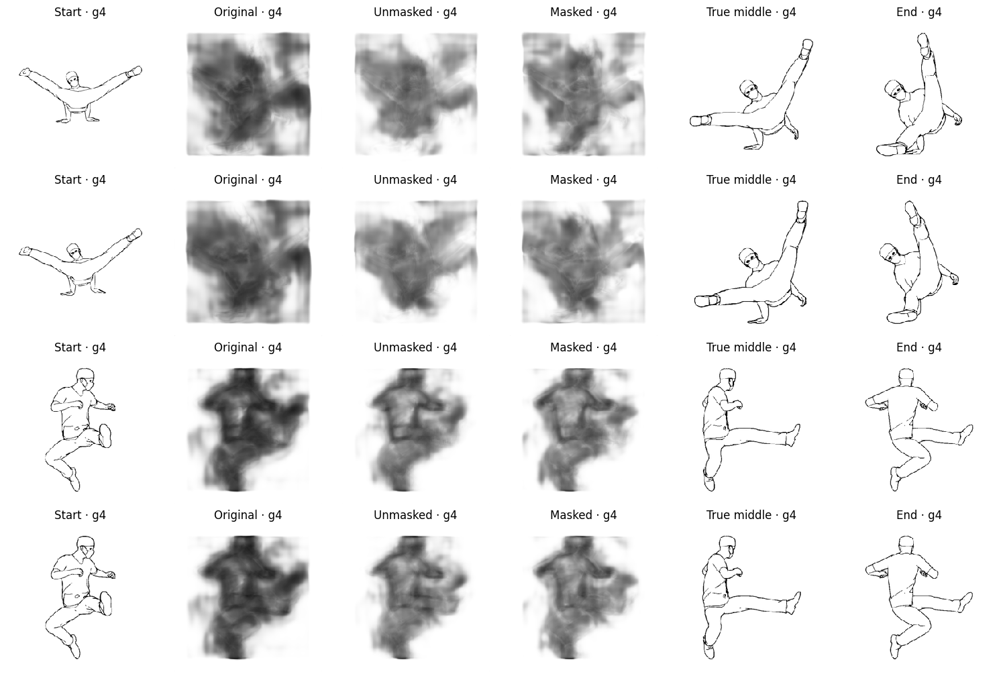

*Selected low-F1 examples, test, gap 4. Across all three model columns the spread of gray ink obscures the limb boundaries. In the bottom two rows the reference kick extends horizontally while the predictions concentrate around the torso. These cases were selected by original-checkpoint F1.*

## 07 · Change the motion inputs while holding the U-Net fixed

`07_Depth_Flow_Experiment.ipynb`

- **Question.** Could better motion inputs separate overlapping lines without another training run? The notebook held the unmasked epoch-13 U-Net fixed and changed only how it formed the two rough midpoint drawings. It sampled 20 validation pairs across sequences.
- **Depth experiment.** Depth Anything V2 Small estimated relative depth in each endpoint. Where source strokes landed on the same midpoint location, the depth-guided warp gave more weight to the nearer pixels. With strength 3, depth slightly reduced F1 and increased ink ratio for all three flow sources. On RAFT-Small, seven cases improved in F1, twelve declined, and one tied.
- **Motion experiment.** AnimeRun-trained GMA gave the highest F1 and smallest Chamfer on these 20 pairs. Feeding its full-resolution flow reduced F1 to **0.78419** and raised the ink ratio to **4.92893×**. The compact flow better matched the feature format the existing U-Net had learned to use. These are paired comparisons on a small sample.
- **Rendering experiment.** On 20 GMA pairs, raising the cutoff from 0.50 to 0.60 reduced ink ratio from 4.3999 to 3.6012 and raised F1 from 0.8009 to 0.8076. At 0.85 the ratio looked better at 1.2670, but F1 dropped to 0.7057 and Chamfer rose to 38.6247 px. Removing weak strokes can make ink area look right while damaging the drawing.

| Motion source, 20 pairs | Ordinary F1 | Depth F1 | Ordinary Chamfer px | Depth Chamfer px | Ordinary ink ratio | Depth ink ratio |
|---|---:|---:|---:|---:|---:|---:|
| Cached RAFT-Small | 0.78460 | 0.78416 | 1.31620 | 1.32059 | 4.84353 | 4.88746 |
| AnimeRun RAFT | 0.79911 | 0.79866 | 1.31027 | 1.30710 | 4.31532 | 4.35334 |
| AnimeRun GMA | **0.80094** | 0.80053 | **1.28012** | 1.28627 | 4.39980 | 4.43308 |

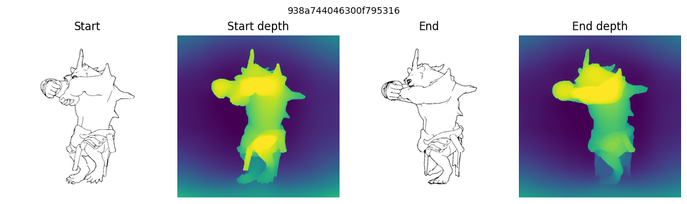

*Depth experiment, validation. These endpoint maps supplied relative depth for weighting overlapping source pixels in the midpoint warp.*

**Why investigate a teacher?** On a further four matched validation pairs, the graph-based AnimeInbet renderer, given the endpoint drawings and their dataset graphs, produced much less excess ink. Coarse GMA plus the U-Net still located more reference strokes under the scoring tolerance. This suggested using the graph renderer’s line style as an additional training signal while keeping ground truth central.

| Four-pair comparison | Line F1 | Chamfer px | MAE | Ink ratio |
|---|---:|---:|---:|---:|
| Epoch 13 with coarse GMA | 0.73323 | 1.39982 | 0.08843 | 5.15322 |
| AnimeInbet with endpoint graphs | 0.69887 | 1.95335 | 0.04132 | 1.66093 |

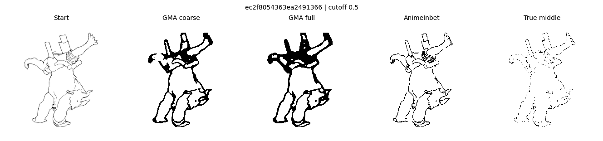

*Notebook 07, one of the four matched pairs. The graph rendering has finer, more separated strokes. The GMA/U-Net panels show heavier contours. All methods are compared against the same true middle.*

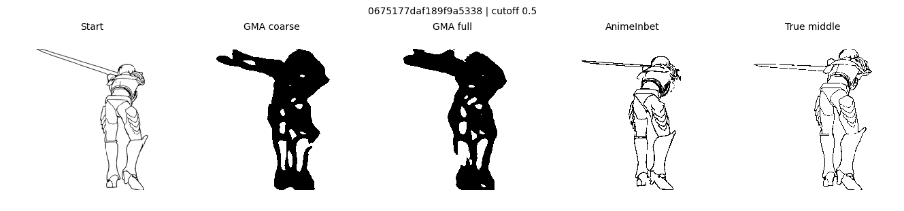

*Distorted ink at cutoff 0.50. Both GMA variants connect the silhouette into large black areas around the shoulder, torso, and legs. The reference has open white space between these contours. Changing the flow resolution alone did little for this pair.*

## 08 · Pilot knowledge distillation against a ground-truth-only control

`08_Distillation_Experiment.ipynb`

- **Design.** Start two copies of unmasked epoch 13 from identical weights. Use cached coarse GMA, the same 512 training triplets (100 sequences), and 96 validation triplets (40 sequences). Train three extra epochs per branch. The control and distilled models shared ink weight 8 and the revised ground-truth objective. Only the distilled branch added teacher supervision.
- **Loss design.** Penalize predicted ink far from true strokes, missing ink near the target, disagreement after spatial pooling, and an incorrect total ink amount. The teacher contribution measures pooled line differences near true strokes. Each example’s teacher weight falls when the teacher has poor F1 or a badly mismatched ink area. Teacher predictions and true middles enter the training loss. The student’s eight input channels still come from the endpoints.
- **Result.** The best extra epoch was the first for both branches. Against the control, distillation gained **0.00020 F1**, reduced MAE by **0.00093**, and increased Chamfer by **0.00647 px**. Most of the pilot’s improvement over its parent also occurred in the ground-truth-only control.
- **Decision.** The pilot’s pre-set selection rule retained epoch 13 because both trained candidates exceeded the allowed **0.02 px Chamfer regression**. The thinner drawings justified a larger trial of the combined training recipe. The pilot alone gave little evidence for an independent teacher advantage.

| Pilot validation, 96 pairs | Line F1 | Chamfer px | Ink ratio | MAE |
|---|---:|---:|---:|---:|
| Parent epoch 13 with GMA | 0.85328 | **0.91655** | 3.80366 | 0.06613 |
| Ground-truth-only control | 0.86544 | 0.95642 | 2.90670 | 0.05151 |
| Distilled student | **0.86565** | 0.96290 | 2.84573 | 0.05058 |
| AnimeInbet teacher | 0.85097 | 1.14534 | 1.52238 | **0.03283** |

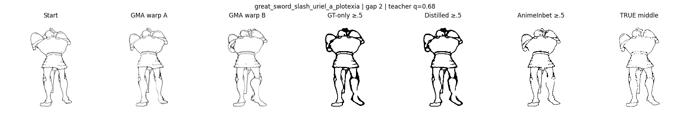

*Notebook 08, pilot validation. The two middle student panels use the same endpoint motion. Compare their stroke width with each other before comparing either with the teacher or reference.*

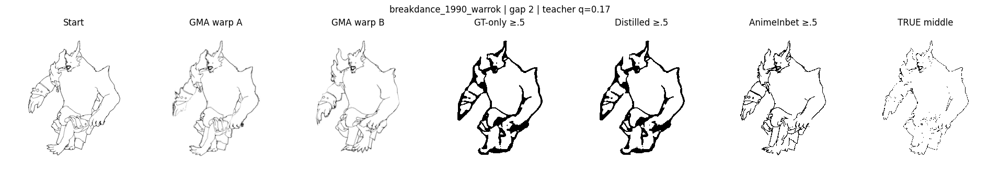

*Pilot, breakdance, gap 2. The ground-truth-only and distilled students both produce heavy contours around the shoulders and legs. The two predictions are visually similar, consistent with the small measured difference between these branches.*

## 09 · Train the distilled student on the full split

`09_Full_Distillation_Training.ipynb`

- **Scale and lineage.** Restart from the verified unmasked epoch-13 weights and train three full epochs (14–16). Each epoch uses all **58,390** training examples. Cache bidirectional GMA and a teacher rendering for each of **87,578** train-plus-validation triplets. The saved run found both caches complete. Sample-level validation results and per-epoch model and optimizer checkpoints made interrupted runs resumable.
- **Training objective.** The full-data run used learning rate **0.00002** and global batch **4** across two devices. The shared objective was ink-weight-8 loss + 0.40 × misplaced-ink penalty + 0.30 × missing-stroke penalty + 0.20 × coarse Dice loss + 0.15 × ink-mass penalty. The teacher coefficient was **0.10 at epoch 14** and **0.20 at 15–16**, further scaled by each example’s trust weight. Teacher ink more than three pixels from a true stroke was excluded from the teacher target.
- **Teacher audit.** Mean trust was **0.57861 on train** and **0.49742 on validation**. These are weights on a training signal, not percentages of correct drawings. The validation teacher audit’s mean per-pair ink ratio was 1.71553. The sequence-balanced evaluation below gives 1.53724 because it divides aggregated ink fractions.
- **Fair comparison.** The parent was evaluated again using GMA and the revised objective before updating weights. Its validation F1 here was **0.83581**. The 0.82562 reported in notebook 04B used RAFT inputs. The full run trained only the teacher-assisted branch, so the contribution of the teacher alone is quantified only by notebook 08’s smaller controlled experiment.

### Training examples used in epoch 14

These three triplets belong to the **actual training split consumed in full by epoch 14**. Notebook 01 displayed the first, middle-index, and last training rows in manifest order. Each panel shows the start drawing, true middle target, and end drawing. All three happen to be gap 1. Epoch 14 also trained on gaps 2 and 4. The archive contains these training targets. Notebook 09 saved its student-prediction GIFs from validation rows.

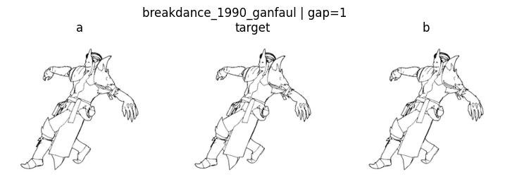

*Breakdance · gap 1. The hand and forearm contours change only slightly around the true middle.*

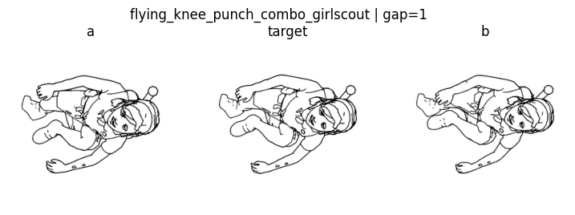

*Flying knee punch combo · gap 1. The model receives the two surrounding poses and is supervised on the center drawing, including the overlapping limbs.*

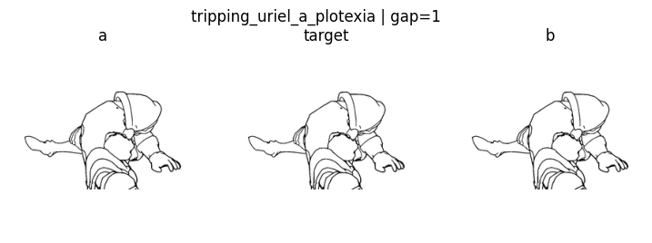

*Tripping · gap 1. A compact silhouette still contains several nearby interior contours that excess ink can merge.*

<details>
<summary>Reproduce the trained epoch-14 predictions for these exact training rows</summary>

Run this cell after the preview helper definitions in notebook 09 with its saved model and GMA cache attached. It uses the same row indices as notebook 01 and renders the student prediction beside the true middle without retraining. This is a reproducibility snippet; its output is not embedded in the supplied archive.

```python
net14 = preview_net(14)
indices = np.linspace(0, len(train_rows) - 1, 3, dtype=int)
fig, axes = plt.subplots(len(indices), 4, figsize=(12, 8), constrained_layout=True)
for row_axes, idx in zip(axes, indices):
    row = train_rows[int(idx)]
    assert row["split"] == "train"
    start, end = load_ink(row["a"]), load_ink(row["b"])
    flow = np.load(flow_path(row), allow_pickle=False)
    pred = middle(net14, start, end, flow)
    target = load_ink(row["target"])
    views = [(start, "Start"), (pred >= 0.5, "Epoch 14 ≥ 0.50"),
             (target, "True middle"), (end, "End")]
    for ax, (drawing, title) in zip(row_axes, views):
        ax.imshow(drawing, cmap="gray_r", vmin=0, vmax=1)
        ax.set_title(title)
        ax.axis("off")
    print(row["id"], row["sequence"], "gap", row["gap"])
fig.savefig(OUT / "epoch14_training_examples.png", dpi=150, bbox_inches="tight")
plt.show()
```

</details>

### Full validation and checkpoint selection

| Model | Val. GT loss | Line F1 | Precision | Recall | Chamfer px | Ink ratio | MAE |
|---|---:|---:|---:|---:|---:|---:|---:|
| Parent 13 with GMA | 1.03779 | 0.83581 | 0.75706 | 0.95318 | 1.03788 | 3.96739 | 0.06830 |
| AnimeInbet teacher | — | 0.82274 | 0.80127 | 0.85144 | 1.31075 | 1.53724 | 0.03300 |
| **Distilled 14** | 0.99591 | **0.84378** | 0.82283 | 0.86916 | 1.29591 | 2.17697 | 0.04405 |
| Distilled 15 | 0.99564 | 0.84272 | 0.82433 | 0.86542 | 1.29798 | 2.07079 | 0.04311 |
| Distilled 16 | 0.99631 | 0.84291 | 0.82189 | 0.86817 | 1.24093 | 2.07700 | 0.04389 |

- **Why epoch 14?** The notebook ranked distilled checkpoints by highest validation line F1, then lowest Chamfer for a tie. Epoch 14 ranked first. Epoch 15 had the lowest validation loss and MAE. Epoch 16 had the smallest Chamfer among the distilled students. Every checkpoint was retained.
- **What improved?** From the GMA parent to distilled 14, the validation ink ratio fell from **3.96739× to 2.17697×**, about **45% less predicted ink area relative to the same reference**. Precision rose by 0.06577 and MAE fell by 0.02425. Recall fell by 0.08402 and Chamfer rose by 0.25803 px. The student learned to use less ink, at the cost of leaving some strokes less well covered.

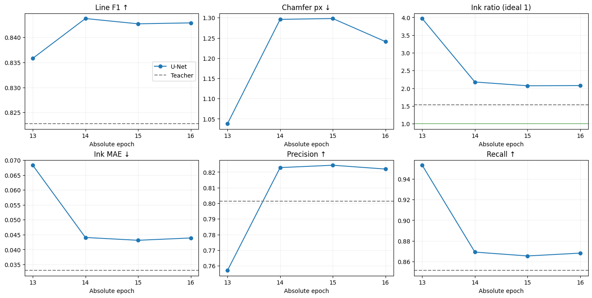

*Notebook 09, recorded validation metrics. The gaps between the three distilled checkpoints are small compared with the parent-to-student change in ink use.*

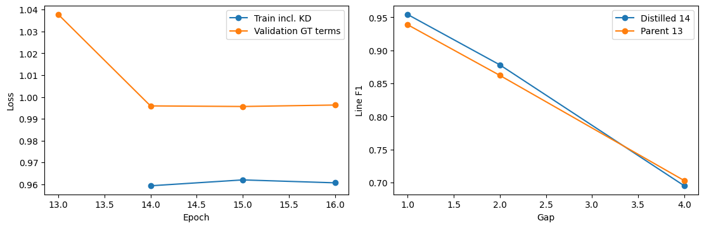

*Full distillation run. The training loss includes the teacher term, while the validation curve uses ground-truth terms only. At right, both models lose F1 as endpoints move farther apart. The change from parent to student varies by gap.*

## 10 · Evaluate the selected model on the full test split

`10_Distillation_Evaluation.ipynb`

- **Protocol.** Load the selected `checkpoints/epoch_014/student.keras`, verify its training and validation metadata, compute or restore coarse GMA flows for the test endpoints, and score all **53,290** triplets. The weights, 0.50 cutoff, and two-pixel tolerance were fixed. This is forward inference. Test scores were also inspected earlier in notebook 06, so this was a held-out-from-training split that the project had already examined.
- **Overall finding.** Test F1 was **0.84077**, only **0.00301** below validation. Test recall was lower and Chamfer higher. Average line distance increased by **0.15480 px**. Test ink area was still **2.00440×** the target. The model generally locates lines well while tending to draw extra ink.
- **Outputs.** The notebook writes per-pair results, overall and per-gap CSVs, per-sequence scores, a validation–test comparison, plots, and fixed-seed previews. Custom-image cells can render recursive animations and choose display cutoff, FPS, or ink color. The formal tables measure **one predicted midpoint**.
- **Checkpoint provenance.** In the later optional custom-preview comparison, the saved log shows both distilled labels resolving to `epoch_016/student.keras`. Those custom GIFs cannot distinguish epochs 14 and 16. The full test scoring cell explicitly loaded `epoch_014/student.keras`. The numbers below come from that verified run.

| Split | Triplets | Line F1 | Precision | Recall | Chamfer px | Ink ratio | MAE |
|---|---:|---:|---:|---:|---:|---:|---:|
| Validation | 29,188 | 0.84378 | 0.82283 | 0.86916 | 1.29591 | 2.17697 | 0.04405 |
| Test | 53,290 | 0.84077 | 0.82947 | 0.85606 | 1.45071 | 2.00440 | 0.05098 |

| Test gap | Endpoint spacing | Triplets | Sequences | Line F1 | Precision | Recall | Chamfer px | Ink ratio | MAE |
|---|---|---:|---:|---:|---:|---:|---:|---:|---:|
| 1 | 2 frame intervals | 18,030 | 100 | **0.96007** | 0.94734 | 0.97415 | **0.46974** | 1.75358 | 0.03134 |
| 2 | 4 frame intervals | 17,830 | 100 | **0.86566** | 0.85224 | 0.88233 | **1.13925** | 2.01704 | 0.05000 |
| 4 | 8 frame intervals | 17,430 | 100 | **0.69053** | 0.68292 | 0.70564 | **2.79986** | 2.25176 | 0.07250 |

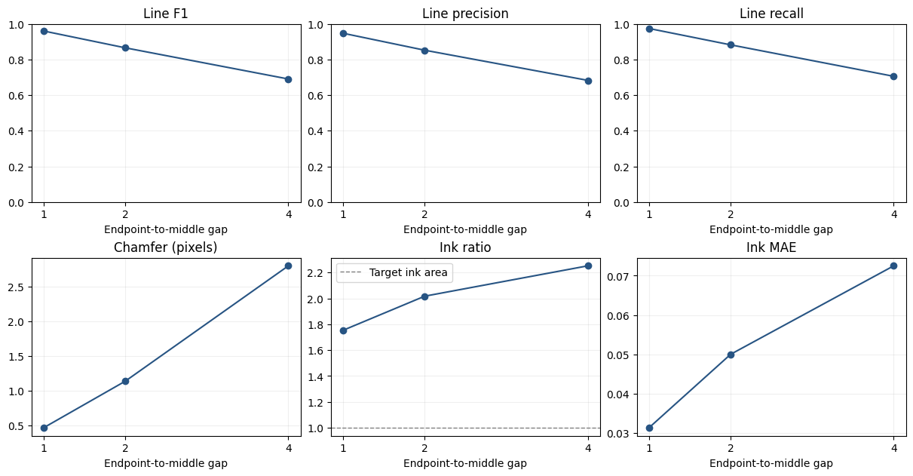

*Notebook 10, aggregate test results. Each gap covers all 100 test sequences. The trend appears in both precision and recall, and in pixel distance and ink area.*

### A difficult gap-4 prediction

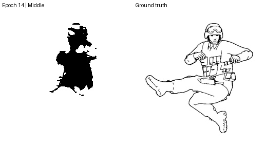

*Fixed-seed test preview, hurricane_kick_police, gap 4. This is the generated midpoint. The reference has a bent leg and an extended foot, while the model leaves a dense central patch and loses most of the extended leg.*

### Successful midpoint drawings from the selected epoch

These screenshots show the generated middle frame from saved notebook animations. The first two come from notebook 09’s epoch-14 validation previews with continuous ink. The last comes from notebook 10’s fixed-seed test preview. The training triplets used in epoch 14 are shown in section 09.

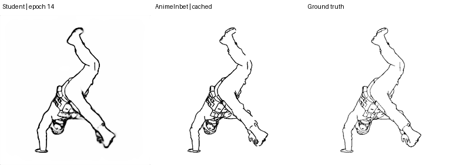

*Breakdance, validation, gap 1. The student keeps the planted hand, bent legs, and open space beneath the raised leg in the same configuration as the reference. Its outline is slightly heavier.*

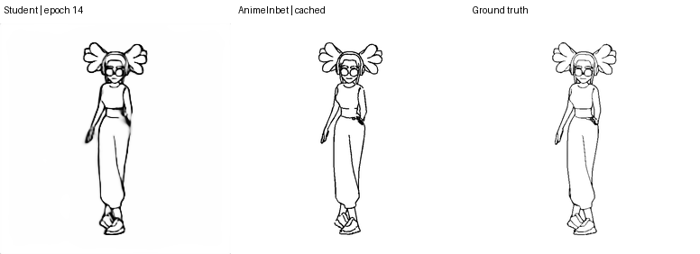

*Hip-hop dance, validation, gap 2. The student preserves the separate hair loops, the shape of the dress, and the crossing ankles. Compare the small remaining differences around the hands with the true middle at right.*

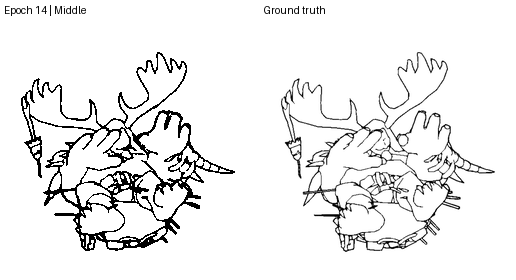

*Zombie stand-up, test, gap 1. The outer silhouette and large projecting shapes align closely with the reference. The interior strokes remain denser. This is the same selected checkpoint that produced the gap-4 failure above.*

## Conclusion

**InterFrames performs very well on closely spaced frames, well at intermediate spacing, and moderately on the longest gap tested.** With two source-frame intervals between endpoints, the predicted and reference lines were less than half a pixel apart on average. At four intervals, F1 remained 0.86566. At eight intervals, both precision and recall fell to around 0.70, with 2.80 px average line distance and more than twice the reference ink area. For this model, the clearest dividing line is how far apart the input poses are in time. The strongest supported use case is generating a single middle drawing between closely spaced line-art frames.
